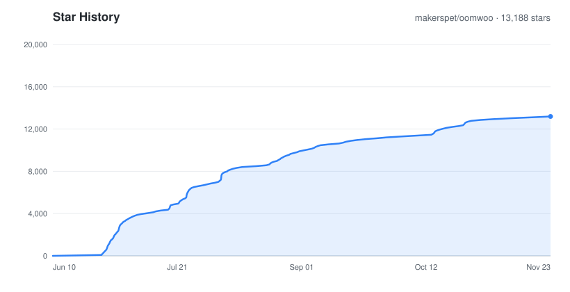

# OOMWOO

*Open-source robot vacuum you build yourself*

Clean well · Hackable · Raspberry Pi · 3D printed · Local / No cloud required · Home Assistant · Arduino · ROS2 · ESP32

OOMWOO is an *open-source home robot vacuum* you can build yourself, built using
Raspberry Pi, 3D-printing, Home Assistant, Arduino and ROS2. It uses an
affordable 2D LiDAR to map your home and navigate on its own. Local, no
cloud required for regular functionality, no vendor lock-in. Follow us building in public
[Discord](https://discord.gg/3y2JKz5T25) | [X](https://x.com/@0OMWO0) | [Instagram](https://www.instagram.com/oomw0o/) | [Facebook](https://www.facebook.com/profile.php?id=61591466775035) | [Reddit](https://www.reddit.com/r/oomwoo/) | [newsletter](https://stats.sender.net/forms/bo2rAK/view) | [YouTube](https://www.youtube.com/@makerspet) | [oomwoo.com](https://oomwoo.com/) | [Tutorials](https://makerspet.com/learn/)

> Not buildable yet - you can run it in simulation today. [Build instructions](docs/BUILD_INSTRUCTIONS.md)
> follow once the first bill of materials is validated on real hardware. See
> [where the build is](https://oomwoo.com/#progress).

Reference design images - this is approximately how the finished design will look:

## Goals

- Affordable, fully open hardware, software and firmware
- Home appliance product quality - not a throwaway build
- Easy to build, with step-by-step zero-to-hero instructions
- 2D LiDAR mapping and autonomous navigation (ROS2 / Nav2)
- Native Home Assistant integration for local control
- 3D-printable, documented, and hackable chassis
- Buildable from parts you source yourself
- Local, no cloud required for regular functionality
- Optional extra functionality when connected to the cloud
- Apps on top of ROS2 to customize vacuum operation
- Stretch goal: App store
- Stretch goal: LeRobot integration, OpenClaw

*v0 target: bare-bones build:*

- 3D-printed chassis ([browse](https://github.com/makerspet/oomwoo-cad))
- ROS2 Gazebo sim ([install](https://github.com/makerspet/oomwoo-install))
- Basic cleaning, mapping
- Raspberry Pi CM4/CM5 running ROS2 ([install](https://github.com/makerspet/oomwoo-install))

Open Source Deliverables:

- [x] [Software development environment](https://github.com/makerspet/oomwoo-install), robot [description package](https://github.com/makerspet/oomwoo-one/) and [tutorials](https://makerspet.com/blog/simulate-oomwoo-one-robot-vacuum-in-gazebo-with-ros-2/) (ROS2)
- [x] Placeholder real vacuum cleaners, temporary while OOMWOO is being designed: [Proscenic M6 Pro](https://github.com/makerspet/proscenic-m6pro) ([tutorial](https://makerspet.com/blog/tutorial-connect-robot-vacuum-cleaner-to-ros-2-proscenic-m6-pro/)) and [Roborock S5 Max](https://github.com/kaiaai/VacuumTiger/tree/feat/roborock-s5max/sangamio) (driver contributed by [@gkfabs](https://github.com/gkfabs), on the `feat/roborock-s5max` branch for now)
- [x] [Bill of materials (BoM)](BOM.md) (rough version available)
- [x] 3D-scanned [sourced parts](https://github.com/makerspet/oomwoo-cad/tree/main/lib)
- [ ] 3D-printable [files](https://github.com/makerspet/oomwoo-cad)
- [ ] Raspberry Pi [software](https://github.com/makerspet/oomwoo-install)
- [ ] Motor drivers, sensors [PCB boards](https://github.com/makerspet/oomwoo-pcb)
- [ ] I/O PCB [firmware](https://github.com/makerspet/oomwoo-firmware)
- [ ] Build, setup, bringup and troubleshooting [instructions](docs/BUILD_INSTRUCTIONS.md)
- [ ] Demo video(s)

## Contributing

Would you like to contribute? See [CONTRIBUTING](docs/CONTRIBUTING.md) for the full guide.

OOMWOO is organized to be built by the community, massively *in parallel*.
The vacuum and its software are subdivided into [modules](contributions/README.md), listed on the RFC board.

A volunteer picks whatever module she wants and works on it whenever she wants.
For *code and simulation* modules she builds her package in her *own repo* and sends
a short PR *linking* it from the module; for *docs and specs* she contributes files
in-tree under `contributions/module-name/<her-github-username>`. See
[CONTRIBUTING](docs/CONTRIBUTING.md) for how this works.

Multiple developers are welcome to work on the same module.
The best solution for each module surfaces over time, with the project master having the last call.

1. Pick a contribution from the [RFC board](contributions/README.md).
2. [Let us know](https://github.com/makerspet/oomwoo/discussions) you're working on it and your progress.
3. Check [ARCHITECTURE.md](docs/ARCHITECTURE.md) and
   [SOFTWARE_INTERFACES.md](docs/SOFTWARE_INTERFACES.md) for the system design
   and ROS2 interfaces.

## Requests for Contributions

Every module below is *actionable now* — build it against the Gazebo simulation
([oomwoo-one](https://github.com/makerspet/oomwoo-one)) or a real *placeholder robot*
(a [Proscenic M6 Pro connected to ROS2](https://makerspet.com/blog/tutorial-connect-robot-vacuum-cleaner-to-ros-2-proscenic-m6-pro/) or a
[Roborock S5 Max](https://github.com/kaiaai/VacuumTiger/tree/feat/roborock-s5max/sangamio)),
until OOMWOO hardware is ready. Pick one, tell us in
[Discussions](https://github.com/makerspet/oomwoo/discussions), build it in your own
repo (docs and specs go in-tree), and send a short PR linking it from the module.

Every RFC — software, firmware, hardware and procurement — lives on the
**[RFC board](contributions/README.md)**, together with its current progress and
status. That board is the single source of truth, so this page links to it rather
than copying it: a second copy here only ever drifts out of date. Broadly:

- **Software & simulation** — cleaning, localization & navigation, perception, the Gazebo sim
- **Firmware & electronics** — CH32 MCU I/O board firmware, the I/O + motor-driver PCB, the board interface
- **Mechanical & procurement** — brushes, blower fan, dust bin, part specs and STEP models

**[→ Browse the RFC board and pick a module](contributions/README.md)**

> Planned and on-hold modules (mechanical design, later-phase software) live in the
> [RFC backlog](docs/RFC_BACKLOG.md).

## Source code reference

- [OOMWOO ROS2 and Ubuntu installation](https://github.com/makerspet/oomwoo-install/) source code
- [OOMWOO One ROS2 robot description package](https://github.com/makerspet/oomwoo-one/) - URDF, Gazebo simulation, config
- [remakeai reference vacuum teardown](https://github.com/remakeai/vacuum_cleaner_teardown) — a consumer LiDAR vacuum with a basic dock and stationary mop.

## Related prior art

- [Valetudo](https://github.com/Hypfer/Valetudo) — cloud-free firmware replacement for commercial vacuums (local app-level control, not ROS2)
- [codetiger/VacuumTiger](https://github.com/codetiger/VacuumTiger) - 3irobotix CRL-200-based vacuum low-level control reverse engineered
- [kaiaai/VacuumTiger](https://github.com/kaiaai/VacuumTiger) - our fork: the SangamIO driver for the Proscenic M6 Pro (CRL-200S) and the Roborock S5 Max
- [kaiaai/LDS](https://github.com/kaiaai/LDS), [kaiaai/lds2d](https://github.com/kaiaai/lds2d) — open-source 2D LiDAR libraries (C++, Python) supporting 23+ LiDAR models
- [remakeai/vacuum_ros2_bridge](https://github.com/remakeai/vacuum_ros2_bridge) — ROS2 bridge for vacuums running SangamIO (Proscenic M6 Pro, Roborock S5 Max), full ROS2 control
- [Dennis Giese / robotinfo.dev](https://robotinfo.dev) — teardowns and rootability of commercial robot vacuums.
- [Build a ROS2/LiDAR robot crash course](https://makerspet.com/blog/build-arduino-self-driving-robot-video-instructions/) - watch this if you have no robotics experience
- [Open Mower](https://openmower.de) - open-source outdoor lawn mower
- [AlieksieievYurii/vacuum-cleaner](https://github.com/AlieksieievYurii/vacuum-cleaner) — a DIY 3D-printed robot vacuum (Raspberry
  Pi Zero W, gyroscope-based, Fusion 360, Android control app, no dock)

## User requirements &amp; Design research

Anecdotal prospective user requirements - collected mostly in [r/RobotVacuums](https://www.reddit.com/r/RobotVacuums/), [r/ROS](https://www.reddit.com/r/ROS/) and as [announcement post](https://makerspet.com/blog/building-an-open-source-robot-vacuum-meet-oomwoo/) comments:

- open-source
- 3D printed first
- cleans well, a first-class appliance, not a throwaway build
  - never gets stuck
  - hair tangle-free
  - modern capabilities - no legacy drag mop; dual-spinning rotary mop or better/roller
  - bagless
- hackable, DIY fixable, upgrade-able
  - examples: vacuum-only version, mop-only version
  - Raspberry Pi
  - Home Assistant integration
- operates without cloud
- later: ability to retrofit existing legacy vacuum cleaner robots

## About

The project name "OOMWOO" is a rotational ambigram - it reads the same flipped 180°, like the robot itself, roaming your floor in every direction.

The project is sponsored by makerspet.com and remake.ai. We are reusing their open-source solutions.
- If you'd rather skip the parts hunt, a kit (motors, PCB, brushes, gaskets, LiDAR) will be available at [makerspet.com](https://makerspet.com), from the same maker behind this project. The kit is a convenience, never a requirement. *Everything here stays open.*
- When we get to apps, [remake.ai](https://remake.ai) will be providing its robot apps platform and app store. Using the app store will be entirely optional. The vacuum will *always support cloud-free, local operation for regular functionality out-of-the-box*. 

## License

Code is released under the [Apache License 2.0](LICENSE).

Hardware design files, once added, to be released under an open hardware
license (TBD).

<!-- Self-hosted star history (auto-refreshed by .github/workflows/star-history.yml).
     No third-party embed / sealed token to expire. -->
<picture>
  <source media="(prefers-color-scheme: dark)" srcset=".github/assets/star-history-dark.svg" />
  <source media="(prefers-color-scheme: light)" srcset=".github/assets/star-history-light.svg" />
  
</picture>
